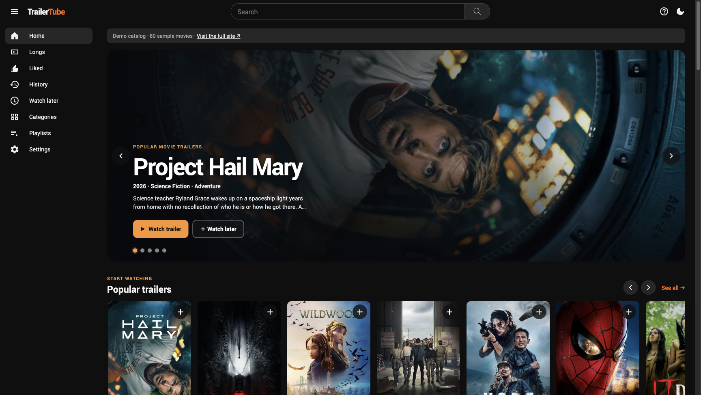

# TrailerTube · Showcase

A small, runnable showcase of [TrailerTube](https://trailer.terryso.dev/), a movie-discovery interface centered on trailers. This repository includes a fixed sample of **80 movies** so you can explore the interface locally without API credentials or downloading the production catalog.



## Features

- Discover popular trailers in a draggable, responsive carousel.
- Browse movie posters, genres and curated playlists.
- Search the sample catalog and open a movie's trailer page.
- Play trailers through YouTube only after clicking play.
- Save likes, viewing history and Watch later locally in the browser.
- Toggle the theme and use keyboard shortcuts (`?` shows the list).

The data is a small, static snapshot, not a live feed or the full production catalog. Search, categories, playlists and popularity are limited to that snapshot. Trailer availability, images and counts can change. The showcase does not include the separate adult catalog, production collection pipeline, deployment configuration, analytics, or the production Agent API.

## Run locally

Requirements: Node.js **22.12 or newer** and npm.

```sh
git clone https://github.com/terryso/trailertube.git
cd trailertube
npm ci
npm run dev
```

Open the address printed by Vite (normally <http://127.0.0.1:5173/>). No API keys are needed. Movie images are fetched from TMDB and the embedded player uses YouTube, so those features require network access.

```sh
npm test       # Run catalog and utility tests
npm run build  # Create the static site in dist/
npm run preview
```

## How it works

The React + Vite frontend reads the compact JSON sample under `public/data/` through the same catalog client used by the full interface. `public/adult-data/` contains an empty placeholder for the separate catalog interface; it contains no adult records. Browser storage keeps personal collections on the current device. The static build has no server-side API or credential requirement.

This is a showcase, not a deployment template for the full website: it does not generate the production sitemap, prerendered pages, worker or data API. Deployment to a subdirectory may require configuring Vite's `base` and handling SPA routes on the host.

## Data and attribution

Movie information and image URLs in the sample are sourced from [The Movie Database (TMDB)](https://www.themoviedb.org/). This product uses the TMDB API but is not endorsed or certified by TMDB. Trailers are provided by their respective YouTube uploaders. Posters, artwork, film metadata and video content remain subject to their respective owners' rights; inclusion here does not grant rights to reuse them. The screenshot depicts third-party artwork as part of the interface.

TMDB's [API FAQ and attribution requirements](https://developer.themoviedb.org/docs/faq) describe conditions for its data and images, including separate commercial licensing requirements. YouTube playback is subject to availability, regional restrictions and the rights of the video owner.

No open-source license has been specified for this repository's code. Third-party dependencies and media retain their own licenses and terms.
